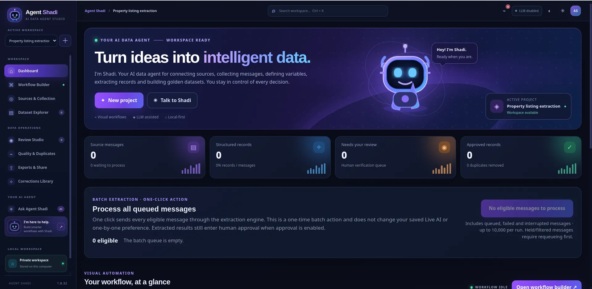
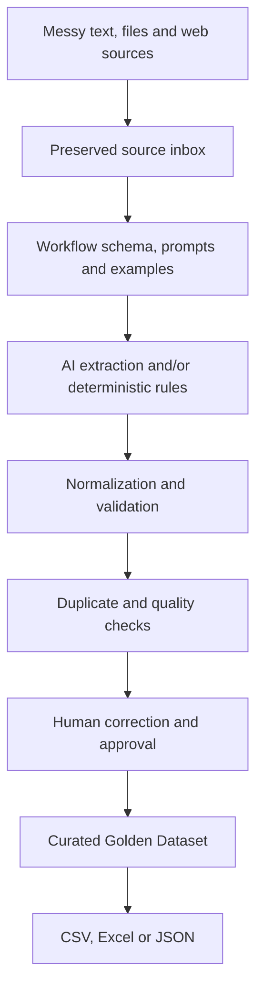

# Agent Shadi

### From messy information to clean, research-ready datasets.

**A local AI-powered data-preparation workbench that transforms unstructured source material into structured records, validated tables, and ready-to-use Golden Data. Export results in multiple formats, such as XLSX, for search engines, other applications, and further research.**

[](VERSION)
[](requirements.txt)
[](#getting-started)
[](LICENSE)



<sub>Agent Shadi dashboard · AI data-preparation workspace</sub>

**Collect → Structure → Normalize → Validate → Review → Export**

</div>

---

## The point of Agent Shadi

In businesses like real estate, valuable information is scattered across messaging platforms, large group chats, and channels where thousands of agents share property listings, daily files, documents, and updates. Much of this information is duplicated, inconsistent, or difficult to search and analyse.

Simply collecting messages or asking AI to return JSON isn't enough. The information needs to be extracted, organized, checked, and prepared for reliable reuse.

Agent Shadi brings the entire process together in one place, from collecting messages to preparing reusable datasets. It transforms messy source material into clean, structured, reviewable datasets that can be used for search systems, analytics, business applications, research, and AI workflows.

Shadi is more than a message collector. Its main purpose is to turn scattered information into data that people can inspect, trust, and reuse.

## Golden Data


**Golden Data is a quality outcome—not a claim that an AI model is always right.**

## More than one way to bring data in

Different teams have different source systems. Shadi supports several input methods that feed into the same data-preparation workflow:

| Input method | What it is for |
|---|---|
| **Paste text** | Add individual items or batches of unstructured text. |
| **Import files** | Bring in TXT, CSV, XLSX, XLSM, XLS, and JSON files, including ZIP archives containing TXT files. |
| **Built-in browser collectors** | Collect from supported Telegram and Rubika web workflows. |
| **Universal Web Connectors** | Configure reusable connectors for other browser-accessible messengers, forums, portals, CRMs, dashboards, and websites. |
| **Source inbox** | Keep captured items available for extraction, review, or later processing. |

### Customer-configurable web connectors

The Universal Web Connector is a connector workbench—not a fixed list of hard-coded integrations. It can inspect a signed-in browser page, identify repeated content elements, map fields, validate CSS selectors against real page samples, and capture content exposed in the rendered page. Where a site supports it, connectors can use loaded content, scrolling, load-more controls, or pagination.

Each website has its own layout and behaviour, so connectors must be mapped and tested against the actual page. Browser connectors work with browser-accessible web applications; they do not control native desktop applications.

**Collection is operator-directed:** each collection run targets one manually selected channel, conversation, or page. You navigate to the intended location yourself; Shadi does not automatically search for channels or switch between them during a run. Collection can follow the configured direction across the selected date range. For faster processing, you can assist by manually scrolling through the conversation to load additional messages while extraction is running.

## The data-preparation toolkit

### Different data, different rules

Not all information is the same, so Shadi lets you choose what information to collect and how to organize it.

**For example:**

- 🚗 **Cars:** You need brand, model, year, price, and mileage.
- 💼 **Jobs:** You need job title, salary, location, and contact details.
+ 🏠 **Houses:** You need price, location, area, number of rooms, and property type.

**🏠 Rental properties**

For rental listings, Shadi can be configured to extract:

| Field | What it means |
|---|---|
| Date | When the listing was posted |
| Property Type | Apartment, house, villa, etc. |
| Number of Bedrooms | How many bedrooms the property has |
| Deposit (million toman) | The amount paid upfront |
| Monthly Rent (million toman) | The monthly rental payment |
| Deposit-to-Rent Conversion | Whether the deposit and rent can be converted or negotiated |
| Full Message | The original message as posted |

**🏡 Properties for sale**

For sale listings, Shadi can use a different set of fields:

| Field | What it means |
|---|---|
| Date | When the listing was posted |
| Property Type | Apartment, house, villa, etc. |
| Address | Where the property is located |
| Area (m²) | The property's size in square meters |
| Number of Bedrooms | How many bedrooms the property has |
| Total Price (million toman) | The full asking price |
| Price per Square Meter (million toman) | The price for each square meter |
| Full Message | The original message as posted |

Shadi uses a separate set of rules for each type of project. You can start with an existing template or create your own by choosing the fields you need, explaining what to look for, and setting rules for checking the results.
This way, Shadi knows what information to find, how to organize it, and what to do when something is missing or incorrect.

### How Shadi prepares your data

Connect Shadi to an AI model, either running on your own computer or through an online service. You can use a service such as LM Studio to run a local model.

Shadi can then prepare your data in several ways:

- **Understand messages:** AI reads messages written in everyday language and finds the information you need, even when people write things differently.
- **Follow your table structure:** You choose the columns Shadi should fill in based on your project. For real estate, you might need property type, address, area, and number of bedrooms for properties for sale, or property type, bedrooms, deposit, and monthly rent for rental listings. For other projects, you can define completely different fields.
- **Learn from examples:** You provide sample messages and show Shadi what the correct extracted result should look like.
- **Apply fixed rules:** Shadi can correct or convert information using rules you define. For example, it can convert Persian numbers to English digits, standardize prices, and fix common writing differences. When working with English-language messages, extraction may be more straightforward and require fewer language-specific corrections. Other languages may need additional rules and tuning depending on the model.
- **Work without AI when possible:** Some information can be extracted using simple rules, without asking an AI model.
- **Track where information came from:** You can see whether a value was extracted by AI, filled in by a rule, calculated automatically, or corrected by a person.

You can combine these methods to build a workflow that fits your data and the way you want it prepared.

### Local-model extraction on an AMD RX 580

I ran Agent Shadi with **Qwen3.5-9B-Q6_K** through `llama.cpp` on my **AMD Radeon RX 580 with 8 GB VRAM** and achieved **98% fully automated extraction accuracy** on messy Persian-language real-estate channel messages.

Reaching this result took many rounds of testing and improvement. I repeatedly adjusted the extraction prompts, expanded correction lists, refined instructions, and tuned other parts of the workflow. These adjustments were important because extraction quality depends on more than the model itself. The language being processed, the selected model, the wording of the prompts, and the correction and validation rules all influence the results.

**The 98% figure comes from my own real-world extraction workflow and test collection.** It represents this particular setup, not a universal benchmark or a guarantee for other datasets. Different languages, source materials, models, and configurations may require their own testing and tuning. Human review is still important, especially when accuracy matters.

This is the `llama-server` command I used:

```bash
./llama-server \
  -m "/run/media/kzlca/Home/AI/models/Qwen3.5-9B-Q6_K.gguf" \
  -c 8192 \
  -t 6 \
  -b 32 \
  -ngl 999 \
  --parallel 1 \
  --jinja \
  --reasoning off \
  --host 127.0.0.1 \
  --port 8180 \
  2>&1 | tee llama-server.log
```

The `-ngl 999` option requests maximum available GPU layer offloading, although the actual number of layers placed on the GPU depends on the `llama.cpp` backend, driver, and available VRAM.

The server listens locally at `127.0.0.1:8180`. In my setup, a context window of **8192 tokens** has been sufficient for processing one message at a time. However, the required context size depends on more than the message length. It also depends on the extraction prompt, schema instructions, examples, and any additional information sent to the model.

If you use longer prompts, more examples, larger messages, or want longer conversations with the built-in helper agent **Shadi AI**, you may need a larger context window. You can adjust this setting in LM Studio, `llama.cpp`, or your preferred inference tool.

### Review Studio and Terminal Review Desk

Inspect a proposed record beside its original source. Review provenance, confidence information, warnings, and validation messages; correct values; and keep supported change history. Review selected records in batches with explicit confirmation, or use the keyboard-oriented Terminal Review Desk.

Approval remains a human decision. A confidence score or warning is a signal to inspect—not proof that a record is correct or incorrect.

### Dataset explorer and duplicate cleanup

Search, filter, sort, group, and choose visible columns. Inspect source items alongside records, check field coverage and validation, and use change history and undo for supported edits and soft deletions. Similar-message comparison helps identify duplicates using original source text, not only extracted columns. Similarity is a review aid; it does not blindly merge every record that looks alike.

### Ask Agent Shadi

The in-app assistant can explain workflow state, inspect supported connector and collection diagnostics, update supported non-destructive settings, run a non-persisting extraction test, and start collection or extraction when explicitly requested. It is a bounded product assistant—not an unrestricted shell, SQL, or credential agent—and it does not make approval decisions for you.

### Structured export

Export reviewed records as **CSV, Excel, or JSON** for analytics, reporting, catalog workflows, CRM processes, research, or downstream tools. Keep source context available so records can be traced and checked later.

## Getting started

Agent Shadi runs as a **local web application**. Launch scripts create a Python virtual environment, install dependencies, and start the local service. It is not currently a signed standalone installer or compiled desktop binary.

### Requirements

- Python **3.10 or newer**.
- Internet access for the first dependency installation.
- Chromium or Chrome for browser-based collection. The core application can start without a browser, but browser collectors and web connectors need one.
- An OpenAI-compatible model endpoint for AI-powered extraction and Ask Agent Shadi. A local model server is optional; supported rules-only processing can be used without an LLM.

### Linux

```bash
chmod +x run.sh
./run.sh
```

On Manjaro/Arch, Chromium can be installed with:

```bash
sudo pacman -S --needed chromium
```

### Windows

Double-click **run_windows.bat**. It creates the virtual environment, installs dependencies, checks for a browser, and starts the local service.

### macOS

```bash
chmod +x run_macos.command
./run_macos.command
```

### Open the application

When the launcher reports that Agent Shadi has started, open:

**http://127.0.0.1:8765**

Keep the terminal window open while using the application. Stop the server with **Ctrl+C**.

### First-use setup

1. Open **Model & Settings** and configure an OpenAI-compatible endpoint and model identifier if you want AI-powered extraction.
2. For LM Studio, start the local server, load a model, and use `http://127.0.0.1:1234/v1` as the API base URL.
3. Test the model connection before running AI-assisted extraction.
4. Create or select a workflow and review its schema, instructions, examples, and rules.
5. Add a source by pasting text, importing a file, using a supported built-in collector, or configuring a customer web connector.
6. Run a small test and inspect both captured source items and extracted fields.
7. Review and correct records, inspect duplicates, then export the dataset.

For a concise walkthrough, see [START_HERE.txt](START_HERE.txt). For product goals and architecture, see [PRODUCT_OVERVIEW.md](PRODUCT_OVERVIEW.md).

## Boundaries, privacy, and security

- Browser connectors depend on the content exposed in a website's rendered DOM. Websites can change their layout, virtualize older content, restrict automation, or require manual interaction. Test connectors with real samples before relying on them.
- Sign in yourself in the persistent browser session. Do not give Shadi passwords, cookies, or session tokens.
- Only collect information you are authorized to access and follow applicable platform terms, privacy requirements, and law.
- The launcher binds the service to **127.0.0.1** by default. This is a single-user local application, not a hardened multi-tenant service; do not expose it directly to the internet or an untrusted network.
- Application state is stored under `data/`, including the SQLite database, workflow configuration, source items, exports, and browser profiles. Browser profiles may contain active login sessions; treat them as sensitive.
- In this release, the configured model API key is stored in the local database and **is not encrypted by the application**.
- When using a hosted LLM, source content submitted for extraction is sent to that provider. A local model endpoint can keep inference on your machine.
- Do not commit `data/`, `.venv/`, `config.json`, `.env` files, databases, browser profiles, exports, or logs to a public repository.

## Technology and project structure

- **Python** — application logic and extraction workflows.
- **FastAPI** — local application API and web service.
- **Playwright** — persistent browser sessions and rendered-page inspection.
- **SQLite** — local storage for workflows, source items, records, connectors, settings, and review history.
- **HTML, CSS, and JavaScript** — browser interface.

```text
Agent-Shadi/
├── app/              # API, UI, collectors, connectors and processing logic
├── knowledge/        # Workflow, connector and Golden Data guidance
├── docs/             # Architecture notes
├── examples/         # Fictional, synthetic input examples
├── tests/            # Automated regression tests
├── run.sh            # Linux launcher
├── run_windows.bat   # Windows launcher
├── run_macos.command # macOS launcher
└── review.sh         # Terminal Review Desk launcher
```

## Development and tests

```bash
python -m venv .venv
source .venv/bin/activate  # Windows: .venv\\Scripts\\Activate.ps1
python -m pip install --upgrade pip
python -m pip install -r requirements.txt
python -m pip install pytest
python -m pytest -q
```

Optional checks:

```bash
python -m compileall -q app tests
node --check app/static/app.js
```

Automated tests do not replace live acceptance testing with your own model endpoint, browser session, and source accounts.

## Documentation

- [Start here](START_HERE.txt) — quick installation and first workflow.
- [Product overview](PRODUCT_OVERVIEW.md) — product goals and engineering principles.
- [Golden Data guide](knowledge/golden-data.md) — how to curate a trusted dataset.
- [Changelog](CHANGELOG.md) — release history.
- [Third-party notices](THIRD_PARTY_NOTICES.md) — dependency attribution.
- [Security policy](SECURITY.md) — reporting security issues.
- [Commercial licensing](COMMERCIAL-LICENSING.md) — how business-use permissions are handled.
- [Publishing notes](PUBLISHING.md) — adding the prepared source tree to this repository.

## License and commercial use

**Agent Shadi is source-available under the PolyForm Noncommercial License 1.0.0. It is not an OSI-approved open-source project.** The license permits the noncommercial uses described in the license. Use intended for commercial advantage or monetary compensation requires a separate written commercial license from the rights holder before that use begins.

Public source visibility does not mean unrestricted business use. Do not use Shadi as part of a paid product, revenue-generating service, or commercial business workflow unless you have obtained the separate commercial permission required by the license. The exact terms of [LICENSE](LICENSE) control.

For commercial licensing inquiries, contact the project owner through [the GitHub profile](https://github.com/kzlca). Pricing and scope are agreed separately; this repository does not imply that a commercial license has already been granted. See [COMMERCIAL-LICENSING.md](COMMERCIAL-LICENSING.md).

The PolyForm Noncommercial license is source-available, not an open-source license, because it restricts commercial use. See the [official license text](https://polyformproject.org/licenses/noncommercial/1.0.0) and the [Open Source Initiative's explanation](https://opensource.org/faq).

---

<div align="center">

**Collect carefully. Structure consistently. Validate transparently. Build data you can trust.**

</div>
