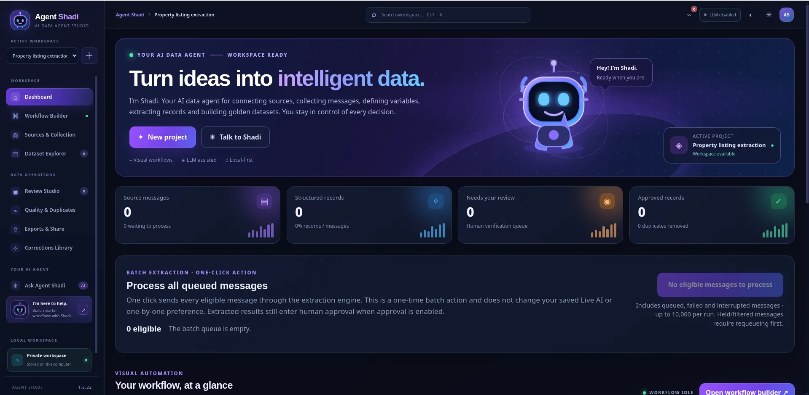
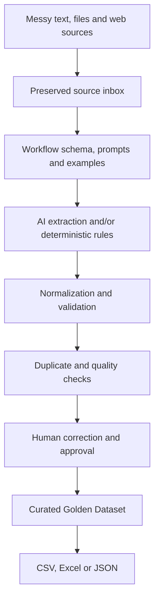

<div align="center">

# Agent Shadi

### From messy information to clean, reviewable datasets.

**A local-first AI data-preparation workbench for turning unstructured source material into structured records, validated tables, and curated Golden Data.**

[](VERSION)
[](requirements.txt)
[](#getting-started)
[](LICENSE)



<sub>Agent Shadi dashboard · local-first AI data-preparation workspace</sub>

**Collect → Structure → Normalize → Validate → Review → Export**

</div>

---

## The point of Agent Shadi

Business information is scattered across messages, documents, spreadsheets, portals, and web applications. The content is often duplicated, inconsistent, incomplete, or written in formats that are difficult to analyse.

A prompt that returns JSON is not a dependable data pipeline by itself. Teams also need a clear schema, repeatable extraction rules, normalized values, validation, duplicate handling, source traceability, and a way for people to correct mistakes.

**Agent Shadi brings those steps into one local-first workspace.** It helps transform dirty source material into structured, reviewable tabular data for analytics, operations, research, catalog management, CRM workflows, and carefully curated AI datasets.

Shadi is not just a message collector. Collection is one input stage; the core value is preparing information so that the resulting dataset can be inspected, trusted, and reused.

## What is Golden Data?

**Golden Data** is a curated dataset whose records have been checked against a defined schema, validated, deduplicated where appropriate, and reviewed by a person. Each record should remain traceable to the source it came from.

AI can propose values, but AI output is not automatically ground truth. Shadi lets an operator inspect the original source beside extracted fields, investigate warnings, correct values, and decide which records are ready to become part of a trusted dataset.



The workflow is designed to preserve original content, check extracted values, highlight missing or contradictory information, support duplicate review, record field provenance, and keep human approval in the loop. **Golden Data is a quality outcome—not a claim that an AI model is always right.**

## More than one way to bring data in

Different teams have different source systems. Shadi supports several input methods that feed into the same data-preparation workflow:

| Input method | What it is for |
|---|---|
| **Paste text** | Add individual items or batches of unstructured text. |
| **Import files** | Bring in TXT, CSV, XLSX, XLSM, XLS, and JSON files, including ZIP archives containing TXT files. |
| **Built-in browser collectors** | Collect from supported Telegram and Rubika web workflows. |
| **Universal Web Connectors** | Configure reusable connectors for other browser-accessible messengers, forums, portals, CRMs, dashboards, and websites. |
| **Source inbox** | Keep captured items available for extraction, review, or later processing. |

### Customer-configurable web connectors

The Universal Web Connector is a connector workbench—not a fixed list of hard-coded integrations. It can inspect a signed-in browser page, identify repeated content elements, map fields, validate CSS selectors against real page samples, and capture content exposed in the rendered page. Where a site supports it, connectors can use loaded content, scrolling, load-more controls, or pagination.

Each website has its own layout and behaviour, so connectors must be mapped and tested against the actual page. Browser connectors work with browser-accessible web applications; they do not control native desktop applications.

**Collection is operator-directed:** one collection run targets one manually selected channel, conversation, or page. You navigate to the intended location yourself; Shadi does not automatically search for channels or switch between them during a run. This keeps collection scope clear without making collection the centre of the whole product.

## The data-preparation toolkit

### Workflow-specific schemas

Define the fields, expected types, required values, extraction instructions, examples, preprocessing, validation behaviour, and collection policy for each dataset. Start with an available profile or create a custom workflow. A property dataset, job dataset, vehicle catalog, supplier list, or internal operational dataset can use different schemas; Shadi does not force everything into the same columns.

### AI extraction and deterministic rules

Connect an OpenAI-compatible chat-completions endpoint, either hosted or local (for example, LM Studio). Shadi can combine:

- AI extraction for interpreting varied, unstructured language.
- Schema-constrained output for the fields you define.
- Input/output examples to demonstrate expected results.
- Deterministic rules such as regular-expression extraction, value mapping, defaults, numeric transforms, and safe formulas.
- Rules-only processing for workflows that should not call an LLM.
- Field provenance showing whether a value came from the model, a rule, a calculation, or a manual correction.

You can test extraction on sample content before processing a larger queue. Rules-only processing is predictable, but does not provide the same semantic interpretation as a language model.

### Local-model extraction on an AMD RX 580

A maintainer-reported local test used **Qwen3.5-9B-Q6_K** with `llama.cpp` on an **AMD Radeon RX 580 with 8 GB VRAM**. In that workflow, the maintainer reports **98% fully automated extraction accuracy** on messy Persian-language real-estate channel messages.

This is a result from one specific workflow and test collection, not a general performance guarantee. The test-set size and scoring methodology have not yet been published as an independently reproducible benchmark. Accuracy can vary with the source material, schema, extraction instructions, model build, and validation rules; review remains important for consequential datasets.

Example `llama-server` command used for that setup:

```bash
./llama-server \
  -m "/run/media/kzlca/Home/AI/models/Qwen3.5-9B-Q6_K.gguf" \
  -c 8192 \
  -t 6 \
  -b 32 \
  -ngl 999 \
  --parallel 1 \
  --jinja \
  --reasoning off \
  --host 127.0.0.1 \
  --port 8180 \
  2>&1 | tee llama-server-qwen35-4b-thinking.log
```

The `-ngl 999` option requests maximum available GPU-layer offload; the layers actually placed on the GPU depend on the llama.cpp backend, driver, and available memory. The server listens locally at `127.0.0.1:8180`.

### Review Studio and Terminal Review Desk

Inspect a proposed record beside its original source. Review provenance, confidence information, warnings, and validation messages; correct values; and keep supported change history. Review selected records in batches with explicit confirmation, or use the keyboard-oriented Terminal Review Desk.

Approval remains a human decision. A confidence score or warning is a signal to inspect—not proof that a record is correct or incorrect.

### Dataset explorer and duplicate cleanup

Search, filter, sort, group, and choose visible columns. Inspect source items alongside records, check field coverage and validation, and use change history and undo for supported edits and soft deletions. Similar-message comparison helps identify duplicates using original source text, not only extracted columns. Similarity is a review aid; it does not blindly merge every record that looks alike.

### Ask Agent Shadi

The in-app assistant can explain workflow state, inspect supported connector and collection diagnostics, update supported non-destructive settings, run a non-persisting extraction test, and start collection or extraction when explicitly requested. It is a bounded product assistant—not an unrestricted shell, SQL, or credential agent—and it does not make approval decisions for you.

### Structured export

Export reviewed records as **CSV, Excel, or JSON** for analytics, reporting, catalog workflows, CRM processes, research, or downstream tools. Keep source context available so records can be traced and checked later.

## Getting started

Agent Shadi runs as a **local web application**. Launch scripts create a Python virtual environment, install dependencies, and start the local service. It is not currently a signed standalone installer or compiled desktop binary.

### Requirements

- Python **3.10 or newer**.
- Internet access for the first dependency installation.
- Chromium or Chrome for browser-based collection. The core application can start without a browser, but browser collectors and web connectors need one.
- An OpenAI-compatible model endpoint for AI-powered extraction and Ask Agent Shadi. A local model server is optional; supported rules-only processing can be used without an LLM.

### Linux

```bash
chmod +x run.sh
./run.sh
```

On Manjaro/Arch, Chromium can be installed with:

```bash
sudo pacman -S --needed chromium
```

### Windows

Double-click **run_windows.bat**. It creates the virtual environment, installs dependencies, checks for a browser, and starts the local service.

### macOS

```bash
chmod +x run_macos.command
./run_macos.command
```

### Open the application

When the launcher reports that Agent Shadi has started, open:

**http://127.0.0.1:8765**

Keep the terminal window open while using the application. Stop the server with **Ctrl+C**.

### First-use setup

1. Open **Model & Settings** and configure an OpenAI-compatible endpoint and model identifier if you want AI-powered extraction.
2. For LM Studio, start the local server, load a model, and use `http://127.0.0.1:1234/v1` as the API base URL.
3. Test the model connection before running AI-assisted extraction.
4. Create or select a workflow and review its schema, instructions, examples, and rules.
5. Add a source by pasting text, importing a file, using a supported built-in collector, or configuring a customer web connector.
6. Run a small test and inspect both captured source items and extracted fields.
7. Review and correct records, inspect duplicates, then export the dataset.

For a concise walkthrough, see [START_HERE.txt](START_HERE.txt). For product goals and architecture, see [PRODUCT_OVERVIEW.md](PRODUCT_OVERVIEW.md).

## Boundaries, privacy, and security

- Browser connectors depend on the content exposed in a website's rendered DOM. Websites can change their layout, virtualize older content, restrict automation, or require manual interaction. Test connectors with real samples before relying on them.
- Sign in yourself in the persistent browser session. Do not give Shadi passwords, cookies, or session tokens.
- Only collect information you are authorized to access and follow applicable platform terms, privacy requirements, and law.
- The launcher binds the service to **127.0.0.1** by default. This is a single-user local application, not a hardened multi-tenant service; do not expose it directly to the internet or an untrusted network.
- Application state is stored under `data/`, including the SQLite database, workflow configuration, source items, exports, and browser profiles. Browser profiles may contain active login sessions; treat them as sensitive.
- In this release, the configured model API key is stored in the local database and **is not encrypted by the application**.
- When using a hosted LLM, source content submitted for extraction is sent to that provider. A local model endpoint can keep inference on your machine.
- Do not commit `data/`, `.venv/`, `config.json`, `.env` files, databases, browser profiles, exports, or logs to a public repository.

## Technology and project structure

- **Python** — application logic and extraction workflows.
- **FastAPI** — local application API and web service.
- **Playwright** — persistent browser sessions and rendered-page inspection.
- **SQLite** — local storage for workflows, source items, records, connectors, settings, and review history.
- **HTML, CSS, and JavaScript** — browser interface.

```text
Agent-Shadi/
├── app/              # API, UI, collectors, connectors and processing logic
├── knowledge/        # Workflow, connector and Golden Data guidance
├── docs/             # Architecture notes
├── examples/         # Fictional, synthetic input examples
├── tests/            # Automated regression tests
├── run.sh            # Linux launcher
├── run_windows.bat   # Windows launcher
├── run_macos.command # macOS launcher
└── review.sh         # Terminal Review Desk launcher
```

## Development and tests

```bash
python -m venv .venv
source .venv/bin/activate  # Windows: .venv\\Scripts\\Activate.ps1
python -m pip install --upgrade pip
python -m pip install -r requirements.txt
python -m pip install pytest
python -m pytest -q
```

Optional checks:

```bash
python -m compileall -q app tests
node --check app/static/app.js
```

Automated tests do not replace live acceptance testing with your own model endpoint, browser session, and source accounts.

## Documentation

- [Start here](START_HERE.txt) — quick installation and first workflow.
- [Product overview](PRODUCT_OVERVIEW.md) — product goals and engineering principles.
- [Golden Data guide](knowledge/golden-data.md) — how to curate a trusted dataset.
- [Changelog](CHANGELOG.md) — release history.
- [Third-party notices](THIRD_PARTY_NOTICES.md) — dependency attribution.
- [Security policy](SECURITY.md) — reporting security issues.
- [Commercial licensing](COMMERCIAL-LICENSING.md) — how business-use permissions are handled.
- [Publishing notes](PUBLISHING.md) — adding the prepared source tree to this repository.

## License and commercial use

**Agent Shadi is source-available under the PolyForm Noncommercial License 1.0.0. It is not an OSI-approved open-source project.** The license permits the noncommercial uses described in the license. Use intended for commercial advantage or monetary compensation requires a separate written commercial license from the rights holder before that use begins.

Public source visibility does not mean unrestricted business use. Do not use Shadi as part of a paid product, revenue-generating service, or commercial business workflow unless you have obtained the separate commercial permission required by the license. The exact terms of [LICENSE](LICENSE) control.

For commercial licensing inquiries, contact the project owner through [the GitHub profile](https://github.com/kzlca). Pricing and scope are agreed separately; this repository does not imply that a commercial license has already been granted. See [COMMERCIAL-LICENSING.md](COMMERCIAL-LICENSING.md).

The PolyForm Noncommercial license is source-available, not an open-source license, because it restricts commercial use. See the [official license text](https://polyformproject.org/licenses/noncommercial/1.0.0) and the [Open Source Initiative's explanation](https://opensource.org/faq).

---

<div align="center">

**Collect carefully. Structure consistently. Validate transparently. Build data you can trust.**

</div>